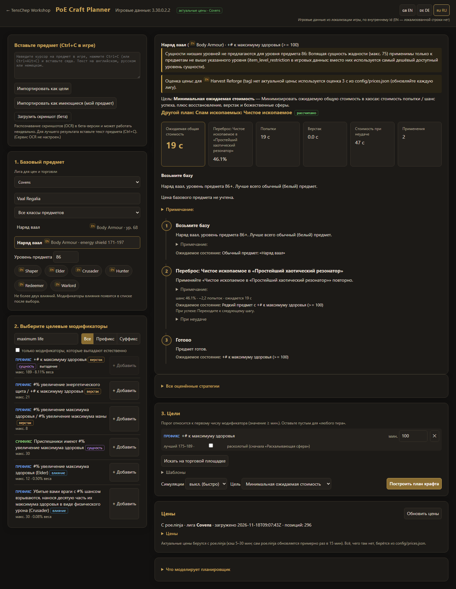

# TensChep Workshop

**От найденного предмета к осмысленному крафту в Path of Exile 1.**

[Скачать для Windows](https://github.com/tentateurss/TensChep-Workshop/releases) · [Документация](docs/README.md) · [Ограничения](docs/LIMITATIONS.md) · [Идеи развития](docs/PROJECT_VISION.md)

Локальный планировщик крафта, оценщик предметов и инструменты Timeless Jewels. Интерфейс работает в браузере на русском, английском и немецком.

<details>
<summary>Посмотреть заполненный Craft Planner</summary>



Пример интерфейса на изолированных данных 3.30; показанные цены зависят от момента проверки и лиги.
</details>

## Возможности

| Инструмент | Что можно сделать |
|---|---|
| **Craft Planner** | Выбрать базу и модификаторы, сравнить маршруты Essence/Fossil/Bench, стоимость и вероятности. Лучший маршрут и первый шаг видны сразу; подробности раскрываются по необходимости. На телефоне сравнение представлено карточками. |
| **RecoveryMDP** | Вставить частично готовый предмет и рассчитать продолжение с учётом текущих модов и ветвей неудачи. |
| **Item Evaluator** | Автоматически оценить Normal/Magic/Rare/Unique и неопознанные предметы. Адаптивный Rare-поиск показывает важные моды, снятые фильтры и качество аналогов. |
| **Timeless Jewels** | Исследовать seed и эквивалентные эффекты выбранных узлов. Несовместимые данные блокируются, неподтверждённые результаты помечаются. Совместимость с 3.30 не подтверждена. |
| **Экономика** | Цены poe.ninja и официальный Trade с изоляцией лиг, включая проверенные сценарии Covens. Оценки и устаревшие снимки отмечены отдельно. |

## Скачать и запустить

1. Откройте [GitHub Releases](https://github.com/tentateurss/TensChep-Workshop/releases) и выберите выпуск. Beta — тестовая версия.
2. Скачайте **TensChep-Workshop-Windows-x64.zip** и распакуйте **всю папку** в доступное для записи место.
3. Запустите **TensChep-Workshop.exe**. Python, pip и права администратора не нужны.
4. При первом запуске потребуется интернет для загрузки игровых данных. Откроется **http://127.0.0.1:8765**.

Не отделяйте EXE от `_internal`. Для остановки закройте консоль приложения или нажмите Ctrl+C. При ошибке сети восстановите подключение и повторите запуск.

## Обновления и ваши данные

В главном окне выберите канал **Beta** для тестовых выпусков или **Stable** для стабильных, затем нажмите «Проверить обновления». Фоновая проверка выполняется не чаще раза в сутки. Установка начинается **только после подтверждения**. Внешний помощник сохраняет предыдущую папку и восстанавливает её при обычной ошибке запуска новой версии.

Для ручного обновления остановите приложение и распакуйте новый ZIP в отдельную папку. Данные сохраняются в **`%LOCALAPPDATA%\TensChep Workshop`**: база, шаблоны и кеши — в `data`, настройки — в `config`. Для переноса на другой компьютер скопируйте эту папку при остановленном приложении.

**Обновление программы и игровых данных — отдельные операции.** Новый EXE не переключает вашу базу с 3.29 на 3.30. Фактическая версия экспорта отображается в Planner. Безопасная проверка и обновление описаны в [RELEASE.md](docs/RELEASE.md).

## Ограничения

- Экспорт **RePoE 3.30.0.2.2** импортирован и проверен на изолированной базе. Это **не означает полной поддержки правил крафта 3.30**.
- Частичные metacraft-блокировки поддерживаются только в ограниченных сценариях Annulment. Essence of Trickery и неподтверждённые взаимодействия не следует считать рассчитанными.
- Timeless 3.30 остаётся **UNVERIFIED**: таблицы, дерево и эффекты проверяются отдельно.
- Цена объявления — ориентир, а не гарантированная цена продажи. Неизвестные свойства Unique, немногочисленные аналоги и снятые фильтры снижают достоверность.
- Некоторые расчёты приближённые. Полный реестр — [LIMITATIONS.md](docs/LIMITATIONS.md).
- EXE пока не подписан. SHA-256 проверяет целостность, но не защищает от компрометации источника релиза.

## Направления развития

Статусы описывают текущее состояние. **Сроков и фиксированной очереди нет.** Подробности и открытые вопросы — в [PROJECT_VISION.md](docs/PROJECT_VISION.md).

| Возможность | Статус | Содержание |
|---|---|---|
| Windows portable, EN/RU/DE, обновления | Работает | Stable/Beta, подтверждение установки, резервная версия. |
| Planner, Recovery, сравнение стратегий | Работает | Поддерживаемые операции, стоимость, вероятности и продолжение после неудачи. |
| Evaluator и адаптивный Rare-поиск | Работает | Учитываемые свойства, ослабленные фильтры, качество аналогов. |
| Полная модель крафта PoE 3.30 | Частично | Экспорт и цены рецептов доступны; часть механик ещё не поддержана. |
| Timeless и эквивалентные seed | Частично | Алгоритмы существуют; соответствие таблиц PoE 3.30 не подтверждено. |
| Evaluator → Planner | Идея | Передача предмета, сравнение продажи и продолжения крафта, риски. |
| Craft Opportunities | Идея | Потенциально востребованные крафты, бюджет, маржа и сценарии убытка. |
| Trade Advisor | Идея | История цен, наблюдение, уведомления, ликвидность. Без автоматической торговли. |
| Acts Assistant | Идея | Гайд по 10 актам, квесты, награды, ориентиры, чеклисты, заметки, возможный overlay. |
| Build Assistant | Идея | Импорт PoB/pobb.in, разбор дерева, камней, экипировки и условий показателей. |
| Acts + Build | Идея | Прохождение и прокачка с учётом билда; каждый модуль работает отдельно. |
| Labyrinth Guide | Идея | Испытания, Ascendancy и схемы при наличии разрешённого источника. |
| Progress Tracker / endgame | Идея | Прогресс, цели экипировки, карты и задачи с ручным контролем. |
| Сообщество и обмен | Идея | Публикации крафтов, билдов, гайдов и исследований, обсуждения и предложения. |
| Связь публикаций с приложением | Идея | Переносимые форматы, открытие стратегий с подтверждением, авторством и версией данных. |
| Аккаунты, синхронизация и сервер | Идея | Модерация, репутация, подписки, хостинг и модель доступа пока не определены. Локальные инструменты сохраняют самостоятельность. |

## Для разработки

Python 3.10+, без сторонних runtime-зависимостей:

```text
python -m poecraft update
python -m poecraft serve
python -m unittest discover -s tests
python -m compileall -q poecraft
```

При подготовке Beta 3: **260 тестов OK отдельно на RePoE 3.29 и 3.30.0.2.2** — все прежние 258 и две новые проверки чистоты ZIP. [Карта исходников](docs/CODEMAP.md) · [Правила разработки](AGENTS.md) · [Сборка и восстановление](docs/RELEASE.md).

Проект не связан с Grinding Gear Games. Права на сторонние данные и обязательные уведомления сохраняются.
